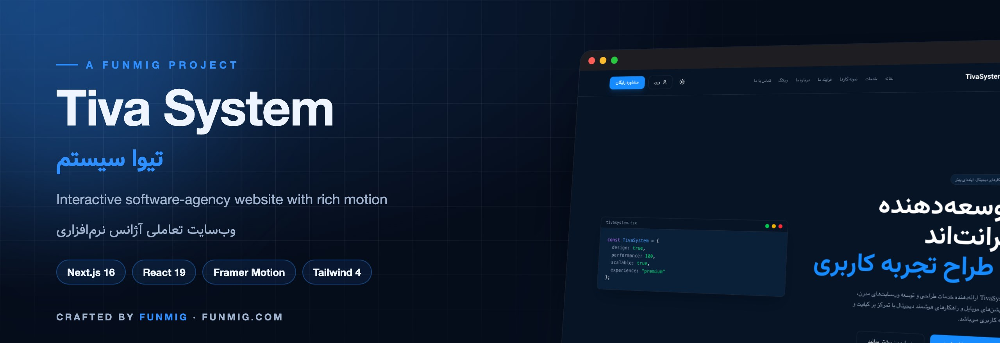
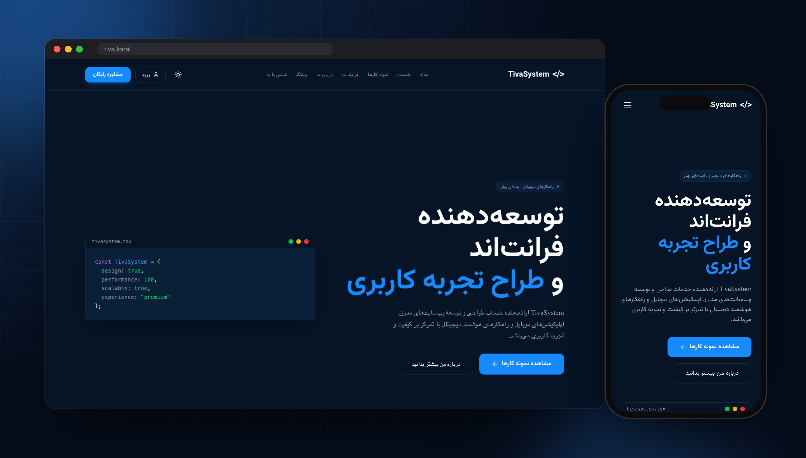
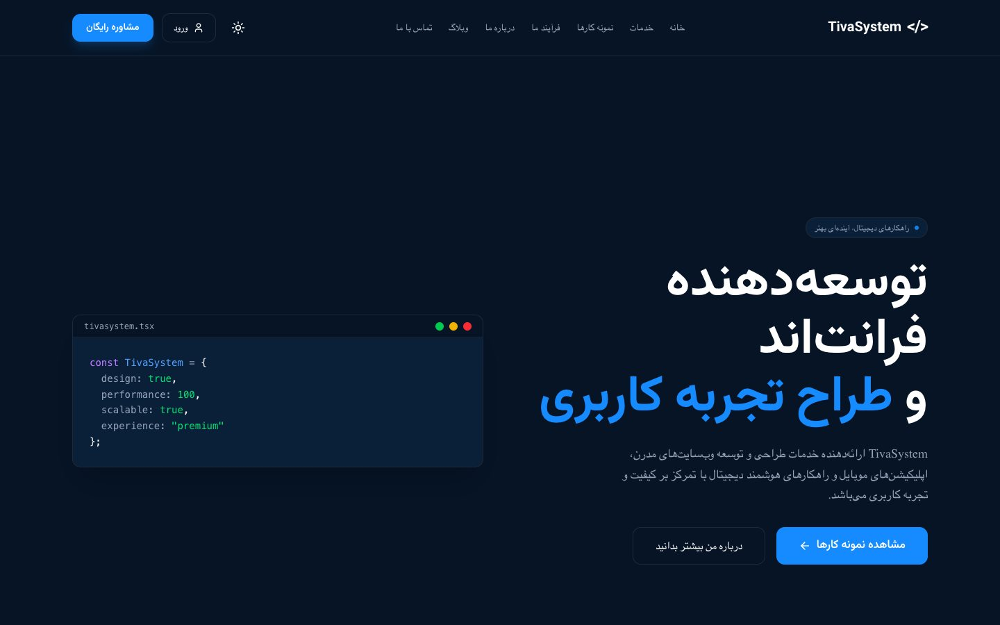
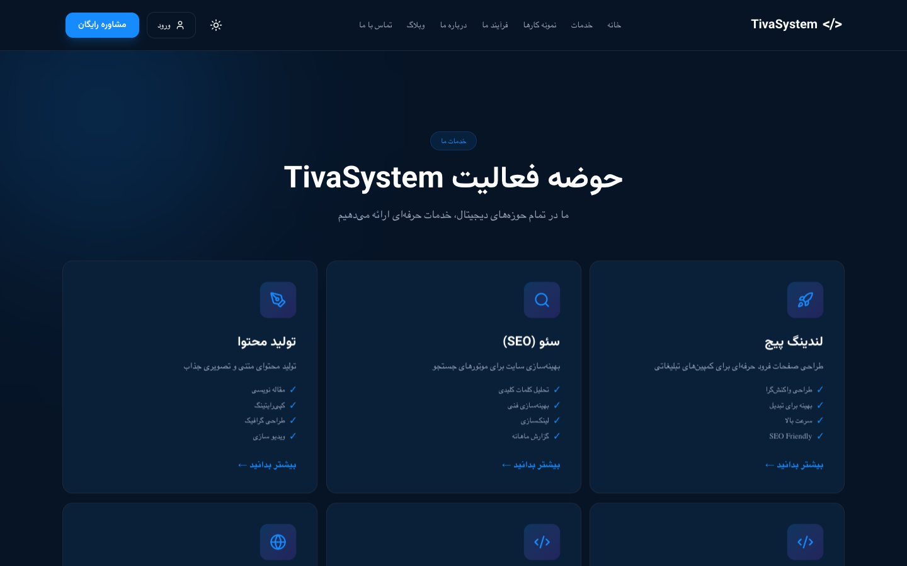
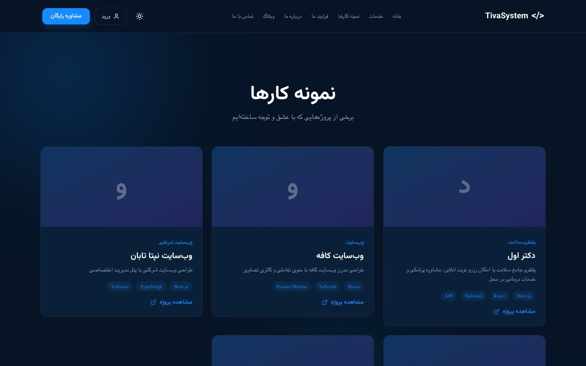
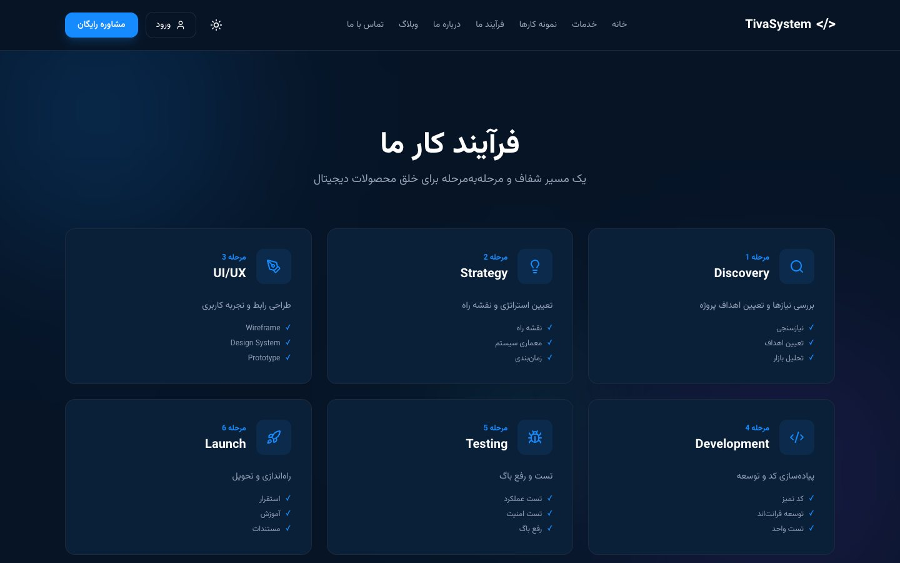
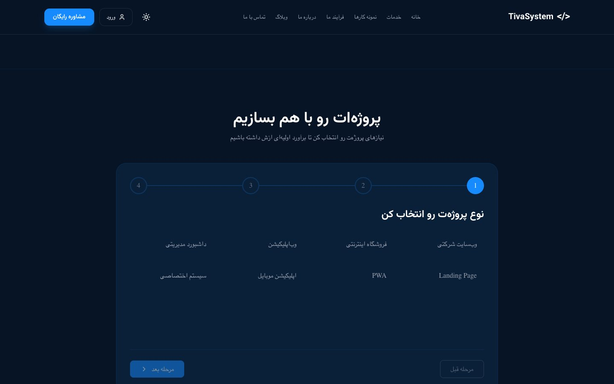
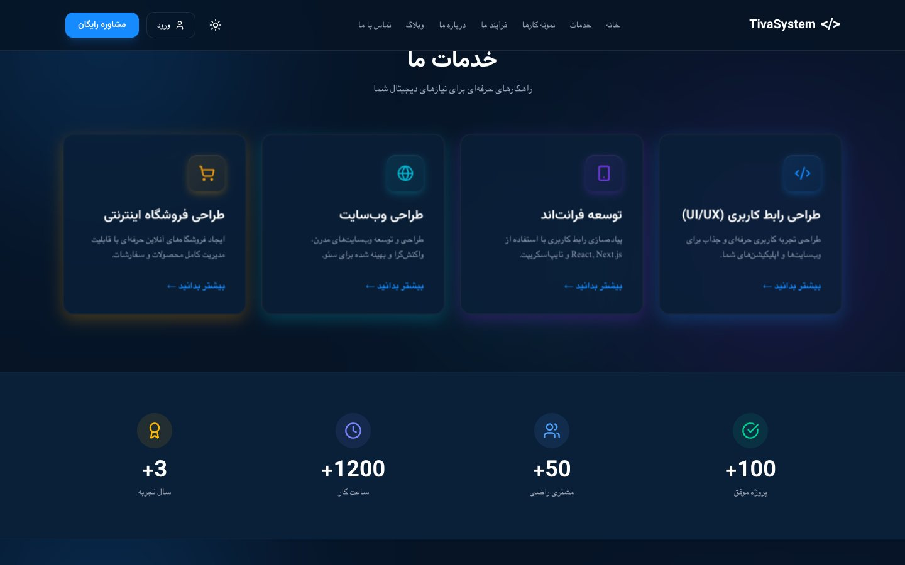
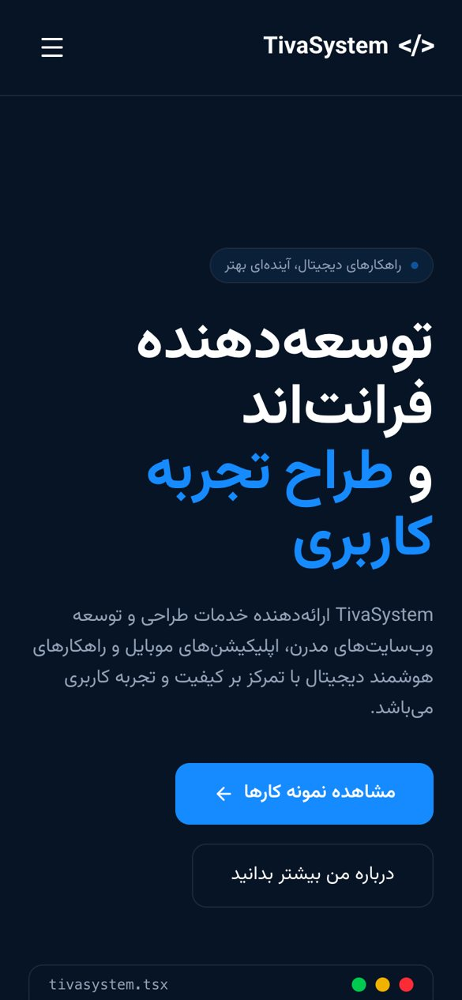

<div align="center">



<br>


<br><br>

**[🇬🇧 English](#-english)** &nbsp;·&nbsp; **[🇮🇷 فارسی](#-فارسی)**

<br>



</div>

<br>

## 🇬🇧 English

**Tiva System** is the website of a digital product studio, built with **Next.js 16 (App Router)**, **React 19** and **Tailwind CSS 4**. It's a dark, right-to-left Persian site with plenty of motion and micro-interactions. Pages are prerendered for speed, and an interactive wizard turns visitors into project leads.

### ✨ Highlights

<table>
<tr>
<td width="50%" valign="top">

#### 🎬 Motion & UI
- Hero with a live **code-window** card
- **Tiva Lab**: an interactive playground where cards tilt in perspective as the cursor moves
- 3D **tilt cards**, ambient gradient blobs and scroll-triggered reveals
- Framer Motion animations throughout
- Dark / light theme provider
- shadcn/ui and Base UI primitives with a custom design system

</td>
<td width="50%" valign="top">

#### 🧩 Product features
- **Project configurator**: a multi-step wizard for project type, scope, features and timeline that ends with a project summary
- Services, portfolio and blog with detail pages
- Interactive **6-step process** timeline: Discovery → Launch
- Stats, tech stack, "Why Tiva", testimonials and CTA sections
- Fully static output: every route is prerendered

</td>
</tr>
</table>

### 📸 Screenshots

| Home | Services |
|:---:|:---:|
|  |  |
| **Portfolio** | **Process** |
|  |  |
| **Start a project** | **Services & stats** |
|  |  |

<p align="center"></p>

### 🚀 Quick start

```bash
npm ci
npm run dev        # http://localhost:3000
```

| Script | What |
|---|---|
| `npm run dev` | Development server |
| `npm run build` | Production build |
| `npm run start` | Serve the production build |
| `npm run lint` | ESLint |

### 🗺️ Routes

```
/                 home (all sections)
/services         services · /services/[slug]
/projects         portfolio · /projects/[slug]
/blog             blog · /blog/[slug]
/process          our process
/start-project    project configurator
/about · /contact · /login · /landing
```

### 🌐 Deployment

<details>
<summary><b>systemd + Nginx (Debian / Ubuntu)</b></summary>

[`deploy/install-server.sh`](deploy/install-server.sh) installs Node.js, builds the app as the project owner, registers a `tiva-system` systemd service on `127.0.0.1:3001` and sets up an Nginx reverse proxy.

```bash
sudo bash deploy/install-server.sh
```

Edit `APP_DIR`, `APP_USER` and `server_name` at the top of the script to match your server.
</details>

### 📂 Structure

```
app/                    App Router pages & layouts
components/tiva/        layout (Header, Footer) · sections · providers · ui (smoothui effects)
components/ui/          shared primitives
hooks/                  useInView
lib/                    data, Persian provinces, utils
public/images/          blog, projects, team
```

<br>

---

<div dir="rtl">

## 🇮🇷 فارسی

**تیوا سیستم** وب‌سایت یک استودیوی طراحی و توسعه محصولات دیجیتال است که با **Next.js 16**، **React 19** و **Tailwind CSS 4** ساخته شده است. سایت فارسی، راست‌چین و تیره است و پر از موشن و جزئیات تعاملی است. صفحات از قبل رندر می‌شوند تا سرعت بالایی داشته باشند، و یک فرم مرحله‌ای هوشمند بازدیدکننده را به سفارش پروژه می‌رساند.

### ✨ امکانات

- هیرو با کارت **پنجره کد** زنده
- **آزمایشگاه تیوا**: محیطی تعاملی که کارت‌ها در آن با حرکت ماوس پرسپکتیو می‌گیرند
- **کارت‌های سه‌بعدی** با افکت Tilt، بلاب‌های رنگی پس‌زمینه و انیمیشن هنگام اسکرول
- **پیکربندی پروژه**: فرم چندمرحله‌ای برای انتخاب نوع، سطح، قابلیت‌ها و زمان پروژه، همراه با خلاصه نهایی
- خدمات، نمونه‌کارها و وبلاگ همراه با صفحه جزئیات هرکدام
- تایم‌لاین تعاملی **فرآیند ۶ مرحله‌ای**، از کشف نیاز تا راه‌اندازی
- بخش‌های آمار، تکنولوژی‌ها، چرا تیوا، نظرات مشتریان و دعوت به اقدام
- تم تیره و روشن، و خروجی کاملاً استاتیک

### 🚀 اجرا

```bash
npm ci
npm run dev
```

سایت روی `http://localhost:3000` اجرا می‌شود. برای نسخه production از `npm run build` و سپس `npm run start` استفاده کنید.

### 🌐 استقرار

اسکریپت [`deploy/install-server.sh`](deploy/install-server.sh) پروژه را build می‌کند، سرویس systemd را روی پورت `3001` ثبت می‌کند و Nginx را به‌عنوان reverse proxy تنظیم می‌کند. پیش از اجرا، مقادیر `APP_DIR` و `APP_USER` را مطابق سرور خودتان تغییر دهید.

</div>

<br>

---

<div align="center">

**Crafted with ❤️ by [FUNMIG](https://funmig.com)**

<sub>طراحی و توسعه توسط تیم فان‌میگ</sub>

</div>
